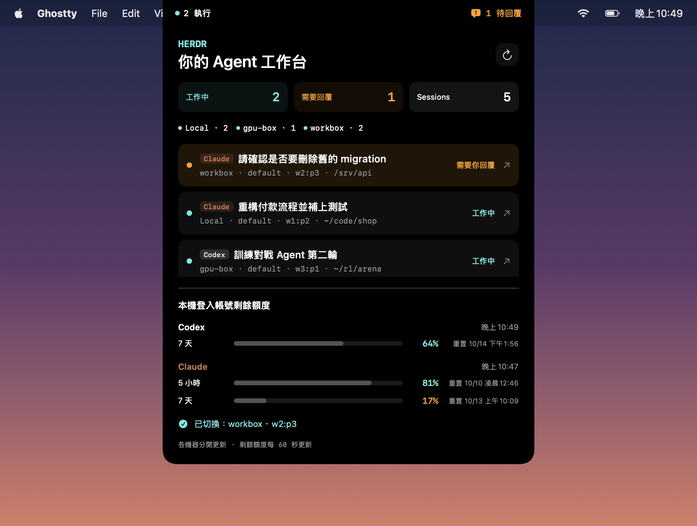
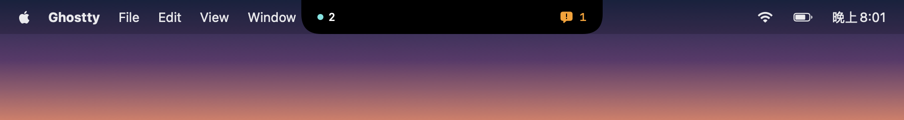
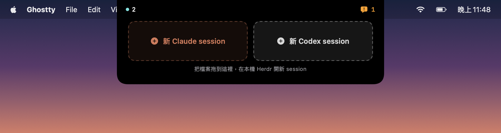
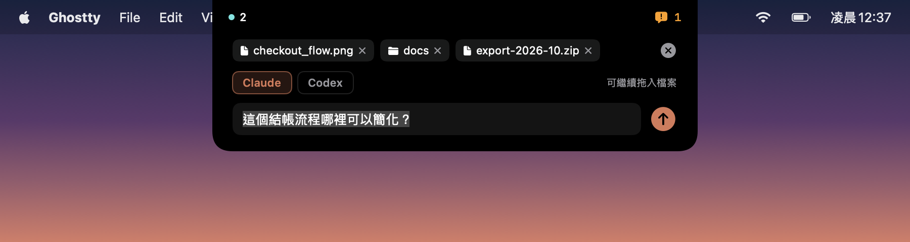

# Herdr Notch

把 MacBook 瀏海變成 [Herdr](https://herdr.dev) 裡 Codex 與 Claude Code agents 的儀表板：一眼看到哪個 agent 在工作、哪個在等你回覆，點一下就跳到那個 pane，本機和 SSH 遠端機器都適用；同時顯示 Codex 與 Claude 的剩餘額度。

*A native macOS notch dashboard for Codex and Claude Code agents running in Herdr, across your Mac and saved SSH machines. Click a row to jump straight to that pane; see both tools' remaining usage at a glance.*

<p align="center">
  
</p>

收合時只佔瀏海兩側，顯示工作中數量與待回覆數量：

<p align="center">
  
</p>

拖曳檔案時，瀏海會半展開成放置區；放開後檔案先暫存在瀏海，打好問題再一起送給新的 Claude 或 Codex session：

<p align="center">
  
</p>
<p align="center">
  
</p>

> 截圖以示範資料繪製自 app 本身的 SwiftUI 介面。

## 功能

- **跨機器清單**：列出本機 Herdr sessions 與所有啟用的 saved SSH machines（`herdr machine list`）上，Herdr 辨識到的 Codex 與 Claude Code agents，每列標示種類，每 3 秒更新。各機器分開讀取，慢的或離線的機器不會拖住其他機器。
- **狀態直接來自 Herdr**：工作中、需要回覆（approval／提問）、已完成、待命、未知。出現新的「需要回覆」會播放提示音。
- **排序**：先依狀態（需要回覆 → 工作中 → 已完成 → 待命），同狀態再依最後使用時間，最近的在前。Herdr 沒有提供時間戳，所以由瀏海自行記錄：agent 狀態改變、你在 Herdr 切到該 pane、或在瀏海點擊它，都算一次使用；紀錄會保留到下次啟動。
- **機器篩選**：點機器標籤（例如 `Local · 3`）只顯示那台機器的 sessions，再點一次恢復全部。
- **拖檔案提問**：從 Finder 或任何 app 拖檔案時，瀏海半展開成「Claude／Codex」兩個放置區。放開後檔案暫存在瀏海，可以繼續拖入更多檔案、切換 agent、輸入問題；送出後在本機 Herdr 開新分頁啟動該 agent、帶著問題與檔案直接開始回答，並跳到那個 pane（見[拖曳檔案開新 session](#拖曳檔案開新-session)）。
- **一鍵跳轉**：點任一列，Ghostty 裡的 Herdr 就會切到那個 agent 的 pane，即使它在另一台機器上（見[跳轉原理](#跳轉原理)）。
- **Codex 額度**：每 60 秒透過 `codex app-server` 讀取帳號剩餘額度與重置時間，用短暫的唯讀 process，不建立對話、不呼叫模型。
- **Claude 額度**：顯示 Claude 訂閱的 5 小時與 7 天用量上限。由 Claude Code 自己的 `/usage` 指令回報（`claude -p /usage`），是帳號層級的數字，涵蓋 CLI、Claude 桌面 app 與其他裝置；這是本機指令，不呼叫模型、不花 token，瀏海也不讀取登入憑證（見[Claude 額度的來源](#claude-額度的來源)）。
- **瀏海互動**：滑鼠移入展開，移出 0.2 秒後收合；透明區域不攔截點擊。沒有瀏海的螢幕會放在畫面頂部中央。右鍵選單列圖示可以隱藏或結束。

## 需求

- macOS 13 以上，以及用來編譯的 Swift toolchain（Xcode 或 Command Line Tools）
- Python 3
- [Herdr](https://herdr.dev) 0.9.1 以上，跑在 [Ghostty](https://ghostty.org) 裡
- [Codex CLI](https://github.com/openai/codex) 和／或 [Claude Code](https://claude.com/claude-code)，沿用你現有的登入，不需要 API key

## 安裝

```sh
git clone https://github.com/seannnnnn1017/herdr-notch.git
cd herdr-notch
./build-app.sh
open "dist/Herdr Notch.app"
```

第一次點擊跳轉時，macOS 會詢問是否允許 Herdr Notch 控制 Ghostty（自動化權限），請允許。

這是 ad-hoc 簽名的開發版本，沒有經過公證。如果改用 Releases 下載的 zip，解壓後需先執行：

```sh
xattr -dr com.apple.quarantine "Herdr Notch.app"
```

### 啟用跨機器跳轉

在 `~/.config/herdr/config.toml` 加入：

```toml
[keys]
next_workspace = "ctrl+alt+n"
previous_workspace = "ctrl+alt+p"
```

接著在 Herdr 裡按 `Ctrl+B`、`Shift+R` 重新載入設定。沒有這兩行時，跳到「目前畫面所在的機器」仍然可用；要跳到別台機器，瀏海會提示你先加上設定。

另外請保留 Herdr 預設的視窗標題格式 `ui.window_title = "{hostname}: {workspace}"`，瀏海靠它判斷 Herdr 目前停在哪台機器。

### Claude 額度的來源

不需要設定。瀏海每兩分鐘執行一次：

```sh
claude -p /usage --output-format json --no-session-persistence
```

這是 Claude Code 內建的本機指令：不呼叫模型（0 token），回報的是整個帳號的用量，所以你在 Claude 桌面 app 或其他裝置用掉的額度也算在內。按瀏海的重新整理鈕會立刻重新讀取。

- 只有 Claude 訂閱帳號（Pro／Max）會回報用量上限；使用 API key 時這一區會顯示沒有資料。
- 舊版 Claude Code 若不把 `-p /usage` 當成本機指令，瀏海偵測到一次後就不再呼叫，避免把它當成問題送給模型。
- **備援（選用）**：讀不到時，瀏海改用 Claude Code statusLine 提供的 `rate_limits`。這份紀錄只在終端機裡的 Claude Code 更新 status line 時才會刷新，所以只用桌面 app 的話會是舊值。要啟用，在 `~/.claude/settings.json` 用隨附的包裝腳本包住你原本的 status line 指令（app 啟動時會把腳本放到下列位置）：

  ```json
  {
    "statusLine": {
      "type": "command",
      "command": "python3 \"$HOME/Library/Application Support/Herdr Notch/claude_statusline.py\" --wrap 'bash ~/.claude/statusline.sh'"
    }
  }
  ```

## 拖曳檔案開新 session

1. 開始拖曳檔案，瀏海會半展開。任何檔案類型、資料夾、多選都可以：瀏海一律只交出路徑，由 agent 自己開啟。
2. 放到「新 Claude session」或「新 Codex session」上，檔案會暫存在瀏海的暫存匣。
3. 在暫存匣裡可以：繼續拖檔案進來追加、按 × 移除、切換 Claude／Codex、輸入問題。Esc 或右上角的 × 取消。
4. 按 Enter 或送出鈕。瀏海在本機 Herdr 的 `default` session 開一個以檔名命名的新分頁，工作目錄是第一個檔案所在的 git repo 根目錄（不在 repo 裡就用它所在的資料夾），並啟動 agent。
5. Ghostty 裡的 Herdr 跳到新分頁；如果 Herdr 當時在看別台機器，會先用[跳轉原理](#跳轉原理)的方式切回 Local。

**有輸入問題時**，問題和檔案路徑會合成一行，當成 agent 的啟動參數（等同 `claude "…"`／`codex "…"`），agent 一啟動就開始回答，不受啟動時的提示（信任資料夾、更新通知）影響。Herdr 不接受含換行的啟動參數，所以問題裡的換行會變成空格。

**問題留空時**，只開啟 agent 並把檔案路徑填進輸入框、不送出。路徑以「bracketed paste」送入，和你把檔案拖進終端機時一樣；啟動提示會忽略貼上的內容，所以不會誤答。瀏海會確認檔名確實出現在畫面上，沒有的話改把路徑放進剪貼簿，並提示你處理完提示後按 ⌘V。

輸入問題時，瀏海面板會暫時取得鍵盤焦點（不會把 app 切到前景）；送出或取消後歸還。開啟失敗時，檔案與問題會留在暫存匣讓你重試。

## 設定

| 環境變數 | 用途 |
| --- | --- |
| `HERDR_BIN` / `CODEX_BIN` | 指定 `herdr` / `codex` 執行檔路徑，預設從 `PATH`、`~/.local/bin`、Homebrew 尋找 |
| `HERDR_CONFIG_PATH` | Herdr 設定檔位置，預設 `~/.config/herdr/config.toml` |

## 限制

- 只列出跑在 Herdr 裡的 Codex 與 Claude Code；不在 Herdr 裡的 terminal、Codex 桌面 app、Claude 桌面 app 的對話不會顯示。
- 額度是這台 Mac 上 Codex CLI／Claude Code 登入帳號的額度；遠端機器若用其他帳號，額度可能不同。Claude 額度是帳號層級的。
- 本機只支援跳到 `default` session（Herdr client 預設連線的 session）。
- 不會自動核准或替你送出任何 prompt。

## 開發

```
Sources/HerdrNotch/
  main.swift               瀏海視窗、SwiftUI 儀表板、點擊流程
  RecentActivity.swift     「最後使用」紀錄與排序
  GhosttyNavigation.swift  跳轉：選 terminal、標題確認、逐格切換機器
  ClientView.swift         從視窗標題判斷機器與 workspace
  TerminalChoice.swift     找出跑 Herdr 的 Ghostty terminal
  InventoryStream.swift    逐機器合併 inventory 事件
Resources/monitor.py       Herdr / Codex / Claude 唯讀資料橋接（inventory、quota、focus）
Resources/claude_statusline.py  Claude Code statusLine 包裝：記錄 rate_limits 後執行原本的 status line
```

測試全部離線執行，不會操作任何 UI：

```sh
python3 -m unittest discover -s tests   # monitor.py 與 statusline 包裝：inventory、遠端逾時、focus、Claude 額度
./tests/check_navigation.sh             # 標題解析、terminal 選擇、模擬側欄逐格切換、最後使用排序
python3 tests/check_lifecycle.py        # 點擊流程與瀏海收合／還原
python3 tests/check_drop.py             # 以模擬拖曳驗證左右兩個放置區與放開後交出的路徑
```

也可以直接看橋接層輸出：

```sh
python3 Resources/monitor.py           # 一次性 inventory
python3 Resources/monitor.py quota     # Codex 與 Claude 額度
```

參考：[Herdr CLI](https://herdr.dev/docs/cli-reference/)、[Herdr socket API](https://herdr.dev/docs/socket-api/)、[Codex app-server](https://learn.chatgpt.com/docs/app-server)

## 授權

[MIT](LICENSE)
