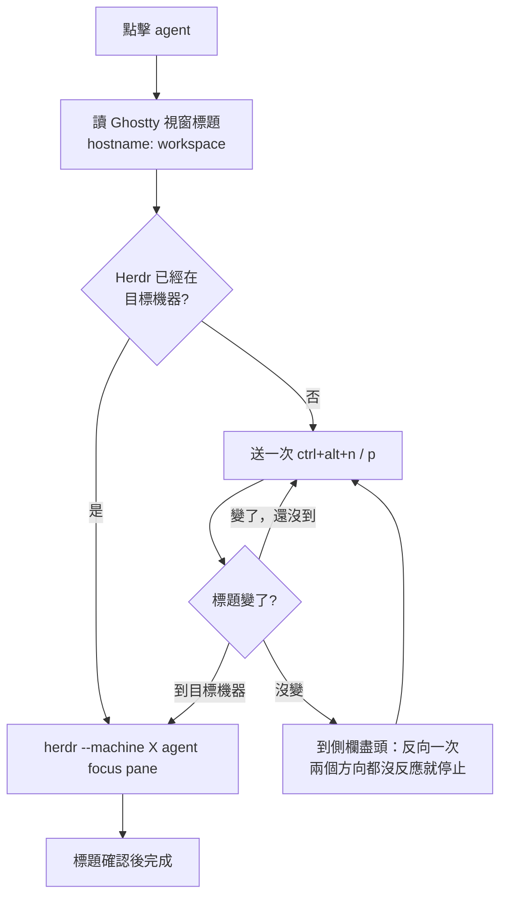

# Herdr Notch

把 MacBook 瀏海變成 [Herdr](https://herdr.dev) 裡 Codex agents 的儀表板：一眼看到哪個 agent 在工作、哪個在等你回覆，點一下就跳到那個 pane，本機和 SSH 遠端機器都適用。

*A native macOS notch dashboard for Codex agents running in Herdr, across your Mac and saved SSH machines. Click a row to jump straight to that pane.*

<p align="center">
  
</p>

收合時只佔瀏海兩側，顯示工作中數量與待回覆數量：

<p align="center">
  
</p>

> 截圖以示範資料繪製自 app 本身的 SwiftUI 介面。

## 功能

- **跨機器清單**：列出本機 Herdr sessions 與所有啟用的 saved SSH machines（`herdr machine list`）上辨識到的 Codex agents，每 3 秒更新。各機器分開讀取，慢的或離線的機器不會拖住其他機器。
- **狀態直接來自 Herdr**：工作中、需要回覆（approval／提問）、已完成、待命、未知。出現新的「需要回覆」會播放提示音，並排在最前面。
- **一鍵跳轉**：點任一列，Ghostty 裡的 Herdr 就會切到那個 agent 的 pane，即使它在另一台機器上（見[跳轉原理](#跳轉原理)）。
- **Codex 額度**：每 60 秒透過 `codex app-server` 讀取帳號剩餘額度與重置時間，用短暫的唯讀 process，不建立對話、不呼叫模型。
- **瀏海互動**：滑鼠移入展開，移出 0.2 秒後收合；透明區域不攔截點擊。沒有瀏海的螢幕會放在畫面頂部中央。右鍵選單列圖示可以隱藏或結束。

## 需求

- macOS 13 以上，以及用來編譯的 Swift toolchain（Xcode 或 Command Line Tools）
- Python 3
- [Herdr](https://herdr.dev) 0.9.1 以上，跑在 [Ghostty](https://ghostty.org) 裡
- [Codex CLI](https://github.com/openai/codex)，沿用你現有的登入，不需要 API key

## 安裝

```sh
git clone https://github.com/seannnnnn1017/herdr-notch.git
cd herdr-notch
./build-app.sh
open "dist/Herdr Notch.app"
```

第一次點擊跳轉時，macOS 會詢問是否允許 Herdr Notch 控制 Ghostty（自動化權限），請允許。

這是 ad-hoc 簽名的開發版本，沒有經過公證。如果改用 Releases 下載的 zip，解壓後需先執行：

```sh
xattr -dr com.apple.quarantine "Herdr Notch.app"
```

### 啟用跨機器跳轉

在 `~/.config/herdr/config.toml` 加入：

```toml
[keys]
next_workspace = "ctrl+alt+n"
previous_workspace = "ctrl+alt+p"
```

接著在 Herdr 裡按 `Ctrl+B`、`Shift+R` 重新載入設定。沒有這兩行時，跳到「目前畫面所在的機器」仍然可用；要跳到別台機器，瀏海會提示你先加上設定。

另外請保留 Herdr 預設的視窗標題格式 `ui.window_title = "{hostname}: {workspace}"`，瀏海靠它判斷 Herdr 目前停在哪台機器。

## 跳轉原理

Herdr 的 `agent focus` API 能精準選定 pane，也會讓正在看那台機器的 client 跟著跳過去。但「client 正在看哪台機器」是 client 端的狀態，Herdr 沒有 API 可以改。所以只開一個 terminal 時，流程是這樣：



- **不讀畫面、不需要「輔助使用」權限**：只讀 Ghostty 的視窗標題（AppleScript），按鍵透過 Ghostty 的 `text:` action 送給指定的 terminal，不經過鍵盤與輸入法。
- **每次只按一下**：等標題變了才按下一次，遠端機器切換較慢也不會多按。Herdr 側欄不會繞回開頭，走到盡頭就反向一次。
- **安全閥**：設定檔沒有綁定那兩個快捷鍵、讀不到標題、或兩個方向都按不動時，都會停下來，不會把按鍵亂送進 agent 的輸入框。
- **辨識機器**：本機看 hostname；遠端看 workspace 名稱，名稱唯一就能辨識，切換成功後也會記住各機器的 hostname。
- 斷線中的機器，標題會顯示成單純的 `herdr`，這時無法跳轉，瀏海會顯示錯誤，其他機器不受影響。

每一步都記錄在 `~/Library/Logs/Herdr Notch.log`（不含終端畫面內容），方便排查。

## 設定

| 環境變數 | 用途 |
| --- | --- |
| `HERDR_BIN` / `CODEX_BIN` | 指定 `herdr` / `codex` 執行檔路徑，預設從 `PATH`、`~/.local/bin`、Homebrew 尋找 |
| `HERDR_CONFIG_PATH` | Herdr 設定檔位置，預設 `~/.config/herdr/config.toml` |

## 限制

- 只列出跑在 Herdr 裡的 Codex；獨立的 Codex terminal 和 Codex 桌面 app 的對話不會顯示。
- 額度是這台 Mac 上 Codex CLI 登入帳號的額度；遠端機器若用其他帳號，額度可能不同。
- 本機只支援跳到 `default` session（Herdr client 預設連線的 session）。
- 不會自動核准或替你送出任何 prompt。

## 開發

```
Sources/HerdrNotch/
  main.swift               瀏海視窗、SwiftUI 儀表板、點擊流程
  GhosttyNavigation.swift  跳轉：選 terminal、標題確認、逐格切換機器
  ClientView.swift         從視窗標題判斷機器與 workspace
  TerminalChoice.swift     找出跑 Herdr 的 Ghostty terminal
  InventoryStream.swift    逐機器合併 inventory 事件
Resources/monitor.py       Herdr / Codex 唯讀資料橋接（inventory、quota、focus）
```

測試全部離線執行，不會操作任何 UI：

```sh
python3 -m unittest discover -s tests   # monitor.py：inventory、遠端逾時、focus
./tests/check_navigation.sh             # 標題解析、terminal 選擇、模擬側欄逐格切換
python3 tests/check_lifecycle.py        # 點擊流程與瀏海收合／還原
```

也可以直接看橋接層輸出：

```sh
python3 Resources/monitor.py           # 一次性 inventory
python3 Resources/monitor.py quota     # Codex 額度
```

參考：[Herdr CLI](https://herdr.dev/docs/cli-reference/)、[Herdr socket API](https://herdr.dev/docs/socket-api/)、[Codex app-server](https://learn.chatgpt.com/docs/app-server)

## 授權

[MIT](LICENSE)
